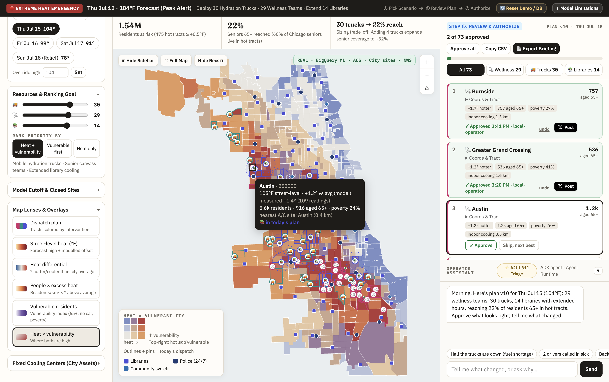

# What Team Scarlett built: hackathon summary

Agents for Impact 2026, Challenge 1 (Community Climate Resilience: Urban Heat). Hackathon day: **Tuesday 17 Nov 2026**
(first commit 09:56 PT, last commit ~15:50 PT). Follow-up demo: **Thursday 19 Nov 2026**.

This file is for us, later. It records what the organizers gave us, what we added during the day (commit by commit),
what the pitch deck and demo script claimed, and where the repo and the slides disagree.

Team (git authors): Sanjay Gurnani (`sgurnani`), Michael Radwin, Srikanth Kusumba (`Srikanth K`), James S
(`jamesshastry`), Arya Krishnan, Vinoo Nedungadan (`Vinooj`). Several commits were written with Claude Code.

---

## 1. TL;DR

- **Track:** *Today* (emergency management). **City:** Chicago. **User:** an emergency-management duty officer deciding,
  the afternoon before a 102°F day, where to send hydration trucks, door-to-door wellness checks and extended
  library / school-gym cooling hours.
- **Product:** the **Heat Dispatch Console**: a React + FastAPI web app on Cloud Run (behind IAP) with a map, plan cards,
  Approve / Skip buttons and an operator chat. The officer approves each pick; every approval is logged.
- **Brain:** a Google ADK multi-agent system on Vertex AI Agent Runtime: one coordinator (`heat_dispatch_agent`) and five
  specialists (spatial risk, logistics, outreach, triage, equity).
- **Data access:** MCP Toolbox on Cloud Run (min-instances=1, private, read-only service account) exposing **11
  parameterized BigQuery SQL tools**. The LLM never writes SQL.
- **Model:** BigQuery ML linear regression that predicts a block's heat **offset** (°F hotter or cooler than the Chicago
  average), served live through `ML.EXPLAIN_PREDICT` so every stop comes with its reasons. Held-out r² went from
  **0.26 (morning model) to 0.59 (v2, promoted the same afternoon)**.
- **Honesty mechanisms:** tool rows are stashed in session state and the dispatch plan is built from them (the model can't
  change a number); a before-tool callback rejects any point outside Chicago; race is never loaded; an equity audit
  reports outcomes (top truck sites hit the most vulnerable tracts at **4.3× the city rate**).
- **Extras:** a signed (HMAC-SHA256) dispatch approval REST API (Firestore / SQLite), a social-media + 311 agent (X posts,
  311 triage), a Streamlit client kept as a fallback, one-command GCP setup, and 170+ offline tests.



*The Heat Dispatch Console in the demo's 104°F scenario (plan v10).* Left: forecast days, resource sliders
(trucks, wellness teams, libraries), rank-priority presets and map lenses. Center: KPI strip (1.54M residents in 475
hot tracts; 22% of seniors 65+ reached; "adding 4 trucks expands senior coverage to ~32%") and the heat × vulnerability
map, with a tract tooltip showing modelled vs measured offset, residents, 65+, poverty and nearest A/C site. Right:
recommendation cards with Approve / Skip / 𝕏 Post, Export Briefing / Copy CSV, the A2UI 311 triage button and the
operator chat with quick prompts ("Half the trucks are down", "2 drivers called in sick").

---

## 2. What the organizers gave us (the "original" repo)

The initial commit (`6dff4c1`, 11 files, ~3.5k lines) was the challenge template:

| File | What it was |
|---|---|
| `README.md` | The challenge brief: three tracks (Today / Budget cycle / This decade), required stack (ADK + Gemini, an MCP server, **a tool you built**, **BigQuery ML**), team lanes, judging rubric (Impact 30, Technical 30, Rigor 25, Craft 15, +10 bonus for range). |
| `notebooks/c1_01_load_explore.ipynb` | Loads and validates the three provided tables (Heat Watch street readings, 7 years of GHCN station highs, Census ACS), with sample queries. |
| `notebooks/c1_90_publish_snapshot.ipynb` | Maintainers only (we never ran it). |
| `scripts/load.sh` | Headless loader for the same snapshot (needs bash 4; on macOS run its three `bq load --replace` commands by hand). |
| `agent/README.md`, `data/README.md`, `scripts/README.md` | One-page placeholders. **`agent/` was empty on purpose:** "We built the on-ramp... We didn't build the vehicle." |
| `LICENSE`, `NOTICE`, `.gitignore`, `.gitattributes` | Boilerplate. |

Everything else in the repo (~240 files, ~28k lines added) is ours.

---

## 3. What we added, in the order it landed

Times are approximate (git mixes PT and UTC). PR numbers refer to `sgurnani/a4i2026-challenge-1-team-scarlett`.

### Morning: the end-to-end skeleton

1. **`f896fb2` Base system (Sanjay, 11:16 PT).** One big commit that made the whole stack work end to end:
   - `sql/00..06`: grid of ~330 m cells, label = measured Heat Watch offset, **physical features only**; tract
     vulnerability index (65+, no car, poverty; equal-weight percentile ranks); `site_context` with nearest indoor
     cooling / library; `CREATE MODEL` (BQML `LINEAR_REG` with `TRANSFORM`); evaluation on **spatially held-out
     ~2.7 km superblocks**; validation checks. Templates rendered by `scripts/run_sql.py` from `sql/chicago.json`.
   - `toolbox/build_tools_yaml.py` → `toolbox/tools.yaml`: 9 MCP Toolbox tools at first (later 11), four sharing one
     scoring CTE that runs `ML.EXPLAIN_PREDICT` live.
   - `agent/heat_dispatch/`: single ADK agent consuming Toolbox over MCP, plus Python tools (NWS forecast, place lookup,
     dispatch sheet built from stored tool output).
   - `client/`: Streamlit UI (in-process or Cloud Run). `scripts/`: loaders, deploy scripts for Toolbox / agent / client.
   - `docs/ARCHITECTURE.md`, `docs/RUNBOOK.md` with honest limits; 56 offline tests.
2. **PR #1 Chicago site snapshots (Michael / Claude).** `tools/fetch_chicago_sites.py` plus a GitHub Actions workflow
   (`.github/workflows/fetch-chicago-sites.yml`) that snapshots City of Chicago open data (cooling centers, libraries,
   police stations, senior centers, CPS schools) into `data/chicago/sites/` as CSV + BigQuery schemas.
3. **PR #2 Multi-agent architecture (Arya).** Split the single agent into **1 coordinator + 5 specialists**
   (`agent/heat_dispatch/subagents/`), and added **CPS high schools as emergency cooling shelters**.

### Midday: four lanes in parallel

4. **PR #3 Data enrichment (James).** Loaders for weather, vulnerability, canopy, transit, cooling, walkability; then
   per-cell **NLCD 2021 land cover** (impervious %, tree canopy %) and **Landsat 8/9 surface temperature** (median of
   14 clear summer scenes 2019–2025), pulled through Earth Engine inside BigQuery. Source notes in `docs/sources/`.
5. **PR #4 Heat Dispatch Console (Michael).** `docs/mockups/concept-d` (the UX spec) and its implementation in `web/`:
   React + Vite frontend (map lenses, City site layers, recommendation cards, chat) and a FastAPI backend
   (`web/backend/heat_console`) that owns the board, plan versions and approvals in BigQuery
   (`dispatch_plan_versions`, `dispatch_approvals`). Shared deterministic planner in `agent/heat_dispatch/planner.py`;
   agent tools `set_operator_constraints` / `replan_dispatch` sync with the console through session state.
6. **PR #5 Social media & 311 agent (Sanjay).** `agent/social_media/`: ingests 311 reports (seniors without AC, mobility
   limits) into vulnerability ranking without broadcasting them, 911 life-safety triage, and X (Twitter) broadcasts
   triggered only by dispatch updates. Streamlit "311 Heat Desk Simulator".
7. **PR #6 Dispatch approval API (Vinoo).** `api/dispatch_api`: proposals → approve → active → override → close, every
   dispatch **HMAC-SHA256 signed**, transactional (no double approval), SQLite locally, Firestore on Cloud Run.
8. **PR #7 Multi-agent runtime fixes (Arya).** Coordinator runs the morning chain itself; callbacks wired to every
   subagent; explicit tool directives in specialist prompts; simulated 311 feed; precomputed
   `client/initial_dispatch_state.json` for instant console load; `AGENTS.md`.

### Afternoon: making it reliable on the real deployment (Sanjay, `sg-contrib` → main)

9. Fixes that the live Agent Runtime exposed (each reproduced by a test):
   - **"Event loop is closed":** Agent Runtime runs each query on a new asyncio loop, so a cached Toolbox client silently
     lost all data tools from the second query on. Fix: `LoopSafeToolboxToolset`, one client per loop.
   - **Same-step race:** Gemini calls the rankings and `build_dispatch_plan` in one step; the plan tool now waits for the
     stashed rows.
   - **Transfer ping-pong:** compound requests bounced between agents up to 11 times. Fix: coordinator keeps whole-plan
     requests, specialists have `disallow_transfer_to_peers`.
   - Client blank bubble, commit shown in the client, `DISPLAY_NAME` so each developer deploys their own engine.
   - Result on the canned "plan tomorrow" prompt: **1/3 and 1/6 successes before, 12/12 after.**
10. **PRs #10, #11, #13, #15 Ops (Vinoo).** `make setup-all` one-command GCP setup (also loads console sites and deploys
    the console), uv-venv support, IAM-binding retries for new service accounts, `/health` instead of `/healthz`
    (Cloud Run reserves it). `deploy_web.sh` got `WEB_PUBLIC` for judging and an explicit `--no-iap`.

### Afternoon: the better heat model (James, PRs #9, #14, #16, #17, #18, #20)

11. **Design first:** `docs/specs/2026-11-17-heat-layers-design.md` (three-layer heat base) and a team update; a plan with
    an adversarial review (`docs/plans/`); a verified BigQuery backup (`a4i_climate_backup_20261117_214035`,
    `docs/DATA_RECOVERY.md`) so the change was reversible.
12. **ACS 2024 on 2024 tract boundaries** in a separate dataset (`a4i_climate_work_v2`): 1,305 cell→tract assignments
    corrected (~26% of cells); facility reconciliation (995 records; every cooling site flagged
    `nearest_cooling_event_verified = false` until someone confirms it is open); OSM routing graphs.
13. **Model v2 `heat_offset_lst`** = location trend + 3×3 Landsat surface heat + NLCD pavement and canopy. Pass bar set
    *before* training: beat trend-only by ≥0.02 r². Result **+0.084**. Promoted ~22:10 UTC, then the enriched toolset
    deployed ~22:45 UTC with a one-command rollback (`scripts/rollback_toolbox.sh`). Secret versions: v6 original, v7
    v2 model, v8 v2 + enriched data (live).
14. `docs/slides/`: generators and the "rigor" / "sources and model" slides used in the deck.

### Late afternoon: the judge-facing console (Arya, PRs #12, #19, #21, #22; Michael, Sanjay)

15. Map fixes (BigQuery `GeometryCollection` tracts, d3 ring winding: `web/frontend/src/geo.ts`).
16. Default **102°F heat-wave scenario**, A2UI action cards, 311 triage, map focus mode, collapsible chat, sidebar / recs
    toggles, a simplified "judge-ready" layout, historic weather toggle, **one-click scenarios**, Title VI audit panel.
17. Bigger cooling-site markers with counts, slider changes announced in chat, markdown in chat, **auto re-plan on 311
    emergencies**, chat Approve applies only the diff, responsive layout, dismissible warnings, **Clear all / reset**
    so judges start fresh, and an **𝕏 broadcast button + vulnerability dispatch modal** on approval (Sanjay).

---

## 4. The system as it stands

```
Duty officer ──IAP──> Heat Dispatch Console (Cloud Run: React + FastAPI)
                         │  board, plan versions, approvals ──> BigQuery
                         │  chat + session state (console_context in / console_plan out)
                         v
                 heat_dispatch_agent (ADK + Gemini on Agent Runtime)
                   ├─ spatial_risk_agent   predict_site_heat, get_forecast_high
                   ├─ logistics_agent      rank_priority_sites, nearest_cooling_facilities
                   ├─ outreach_agent       rank_wellness_check_tracts, who_lives_near
                   ├─ triage_agent         311 calls, cooling-center AC failures
                   └─ equity_agent         equity_audit
                         │  MCP (ID token)
                         v
                 MCP Toolbox (Cloud Run, min-instances=1, read-only SA)
                         │  11 parameterized SQL tools
                         v
                 BigQuery + BQML heat_offset_lst (ML.EXPLAIN_PREDICT)
```

**Toolbox tools (`toolbox/tools.yaml`):** `rank_priority_sites`, `rank_wellness_check_tracts`, `predict_site_heat`,
`who_lives_near`, `nearest_cooling_facilities`, `heat_frequency`, `equity_audit`, `model_card`,
`model_global_importance`, `tract_map_layer`, `list_sites`.

**Morning chain (coordinator):** `rank_priority_sites` → `rank_wellness_check_tracts` → `equity_audit` →
`build_dispatch_plan`. Focused questions ("is this high-school gym usable?") go to exactly one specialist; control always
returns to the coordinator.

**Priority score:** `(heat_weight·heat + (1−heat_weight)·vulnerability) × (0.6..1.0 by distance from indoor cooling)`,
best cell per ~1.7 km block so trucks spread out. `heat_weight` is an operator slider (balanced 0.5, vulnerable-first
0.2, heat-only 1.0) and the equity audit shows the consequence.

**Other parts:** `api/` (signed dispatch lifecycle), `agent/social_media/` (311 + X; not inside the deployed
`heat_dispatch` package), `client/` (Streamlit, kept until the console reaches parity), `scripts/` (setup, load,
deploy, smoke, rollback, backup).

---

## 5. What the deck and demo said (Thursday follow-up)

Two decks were used: the pitch deck ("SVL 1 – Pitch Deck") and a teleprompter script for the demo. Neither PPTX is in
the repo; the content below is from them.

### The problem (pitch slide 2)
- **2,325** Americans died from heat in 2023, the most on record and likely an undercount (Howard et al., JAMA 2024; up
  117% from 1,069 in 1999). *One copy of the slide says 2,235: a typo. 2,325 is the cited figure.*
- **67,500+** heat-illness ER visits and **9,200+** hospitalizations in an average U.S. year (CDC, 2004–2018 average).
- **6.7×** higher odds of heat death for Chicagoans who couldn't leave home each day in the 1995 heat wave (Semenza et
  al., NEJM 1996; also: confined to bed OR 5.5, living alone OR 2.3, top-floor residence OR 4.7).
- Line used: *"Cities know this. What they don't have is a way to decide, block by block, where to send limited help the
  afternoon before a heat wave."*

### The solution (pitch slide 3): three interventions, each with evidence
| Intervention | What | Evidence on the slide |
|---|---|---|
| ❄️ Cooling centers | Libraries, school gyms, rec centers kept open late where residents can walk in | **66%** lower odds of heat death for people who spend time in AC (Bouchama et al., 2007). Speaker notes: ER-visit evidence for cooling centers is mixed. |
| 🚛 Hydration trucks | Water and misting at busy bus stops and corridors far from a cooling center | **24–27%** fewer hot-day farm injuries after California required water, shade, rest (WCRI 2025). Closest proxy; nobody has measured trucks directly. |
| ⛑️ Wellness checks | Door to door where sidewalks are broken and many seniors live | **56%** fewer heat-related ER visits after Adelaide added daily calls to at-risk residents (Nitschke et al., 2016). Deaths did not fall. |

"A duty officer approves or skips each recommendation and says what changed ('2 drivers called in sick'). The agent
re-plans and logs every approval in BigQuery." Who benefits: ~350,000 Chicagoans aged 65+, and nearly 1 in 4
households has no car.

### Data and model (pitch slide 4)
| Model (held-out blocks) | r² | Typical error |
|---|---:|---:|
| Original | 0.26 | 2.06 °F |
| Location trend alone | 0.50 | 1.68 °F |
| **New model** | **0.59** | **1.54 °F** |

Data sources: NOAA Heat Watch (48,855 afternoon air readings, the label); NOAA GHCN-Daily (13 stations, 2019–2025);
and, enriched or new: Census ACS 2024 on 2024 tracts; Landsat 8/9 surface heat (14 clear days); NLCD 2021 pavement and
canopy; City of Chicago (995 reconciled facility records; 287 cooling sites, 134 indoor; 77/77 community areas valid);
OpenStreetMap and NWS 7-day forecast.

Rigor bullets: licenses checked (public domain, ODbL, City open data); **excluded on purpose**: CMAP canopy (no reuse
license) and CTA transit (rider-info only); race never loaded; pass bar set in advance (+0.084); 26% of grid cells
re-assigned to the right tract; top sites in the most vulnerable tracts at **4.3×** the city rate; **23%** of nearby
residents are 65+ vs 14% citywide; poverty 24% vs 17%; every version backed up, rollback is one command. Surface heat
is an input only, never shown as air temperature.

### Architecture (pitch slide 5, teleprompter slides 10–12)
The seven-step walk-through: (1) officer in the console (Cloud Run, IAP), e.g. "two trucks are down"; (2) console sends
the request plus the current board in session state to the coordinator on Agent Runtime; (3) coordinator runs the
morning chain or routes to one specialist; specialists never hand off to each other; (4) every agent calls the same MCP
Toolbox, parameterized SQL only; (5) Toolbox runs the BQML model live with `ML.EXPLAIN_PREDICT`, so every stop has
reasons; (6) agents share data through session state, not model text; a before-tool callback refuses non-Chicago
locations; (7) reply streams back, the console reads the new plan from state, the officer approves. "Nothing dispatches
without a human." Close: *"So the agents recommend, the officer approves, and every number on the plan can be traced
back to a query."*

### Demo script beats (teleprompter slides 3–9)
1. "When a 102°F heat wave strikes Chicago, emergency managers have less than an hour to deploy limited resources."
2. Microclimates: weather stations say 102°F everywhere, but NOAA's Heat Watch survey saw ~**20°F** of street-level
   spread in one afternoon: hottest inland blocks up to ~7°F above average, lakefront up to ~14°F below (the measured
   range in our data is −13.9 to +6.7°F).
3. Logistics agent pairs hydration stops with indoor cooling: extended Chicago Public Library hours and CPS high-school
   air-conditioned gyms.
4. Outreach agent ranks canvassing tracts by elderly share, zero-vehicle households and poverty; Equity agent runs a
   Title VI-style audit against citywide baselines.
5. Dispatch API: "AI recommends, humans authorize"; every approval or change is captured as an audit trail (Firestore),
   later used to publish approved locations to social media.
6. Model in plain words: how much hotter or cooler a block runs than the city average, from where it sits, distance to
   the lake, satellite rooftop / pavement heat and tree canopy; "typically within about one and a half degrees" on
   neighborhoods it never saw. "Better data, a tested model, and an audited outcome, with the limits stated."

---

## 6. Where the slides and the repo differ (read before reusing the deck)

| Slide claim | What the repo actually has |
|---|---|
| "12 parameterized SQL tools" (architecture slide) | **11** tools in `toolbox/tools.yaml` (the teleprompter script says eleven). |
| Agent "deployed to Vertex AI Reasoning Engine / Agent Runtime" | True for the agent. The **console was not yet deployed or run against live BigQuery** at the time of the last notes; Toolbox, agent and Streamlit client were deployed and verified on `qwiklabs-gcp-04-3e58e01275b8`. The agent and console still carried old label maps after the v2 promotion. |
| Approvals "logged in BigQuery" (pitch) vs "audit trail in Firestore" (teleprompter) | Both exist, in different components: the console logs to BigQuery (`dispatch_approvals`, `dispatch_plan_versions`); the separate `api/` service stores signed dispatches in Firestore. The console does not call `api/`. |
| Publishing to "Facebook and X" | Only X/Twitter is implemented (`agent/social_media/twitter.py`). Tweets can post live with no human approval step; that is an open concern. |
| Agents "guarantee environmental justice" | The equity audit *reports* outcomes against citywide baselines; it does not guarantee anything. Race is not used. |
| 2,235 deaths (one slide) | Cited source says 2,325. |

---

## 7. Honest limits and open items

- Heat Watch is **one afternoon, volunteer-driven, no timestamps**: the location trend may partly reflect route order
  (though Landsat, measured everywhere at once, also shows the south/southwest running hot).
- The model predicts an **offset, never a temperature**; expected temp = forecast + offset. Land cover adds little to the
  air model (global importance: location 1.69°F, lake band 1.45, surface heat 0.31, canopy 0.03, pavement 0.01).
- We cannot simulate an intervention's effect and don't claim to.
- Facility hours are snapshots; every cooling site is "listed, not confirmed open" until an operator verifies it.
- Console keeps the live board in memory (`max-instances=1`); one shared board, no per-operator drafts.
- Concerns flagged on main, not fixed: invented fallback hours for high schools (`dispatch.py`), a hard-coded 311
  facility list with made-up phones/hours (`social_media/call_311.py`), tweets without human approval,
  `agent/social_media/` outside the deployed package.
- Deploy gotcha: plain `bash scripts/deploy_toolbox.sh` reverts the enrichment; pass
  `TOOLS_SRC=toolbox/tools.enriched.yaml` to keep the v8 live state.

## 8. Where to look

| For | Read |
|---|---|
| Architecture, decisions, verified-live results, model v2 numbers | `docs/ARCHITECTURE.md` |
| Agent roster and rules | `AGENTS.md` |
| Deploy steps and proofs | `docs/RUNBOOK.md` |
| Data enrichment and recovery | `docs/DATA_ENRICHMENT.md`, `docs/DATA_PROGRESS.md`, `docs/DATA_RECOVERY.md`, `docs/sources/` |
| Heat model v2 design and review | `docs/specs/`, `docs/plans/` |
| Console UX spec | `docs/mockups/concept-d` |
| Approval API | `api/README.md` |
| Original challenge brief and rubric | `README.md` |
